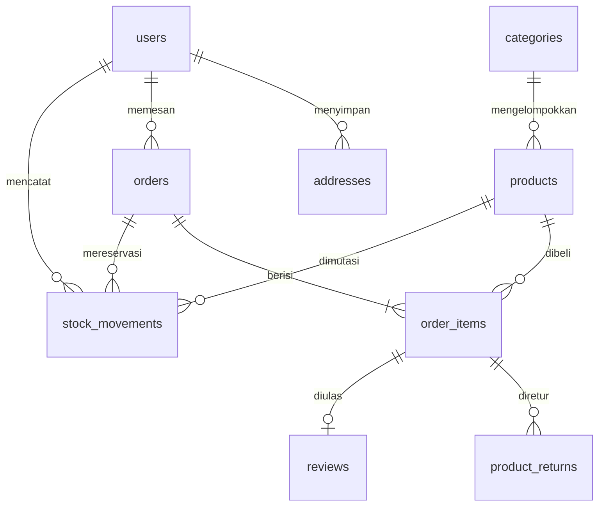

# E-Commerce Toko Maya

Sistem penjualan terintegrasi **Laravel 11, Blade, Tailwind CSS, Vite**, dan database relasional untuk empat peran: pelanggan, kasir, admin gudang, dan pemilik. Mendukung SQLite untuk pengembangan serta konfigurasi MySQL Laravel untuk deployment.

## Fitur

- Katalog dengan pencarian/kategori, detail produk, keranjang dan subtotal server.
- Buku alamat pribadi: tambah/edit/hapus, alamat utama, pemilihan lewat pop-up checkout.
- Checkout satu halaman; invoice `ORD-YYYYMMDD-XXXX`; reservasi/pengurangan stok atomik saat dibuat dan pelepasan sekali jika batal/kedaluwarsa.
- Estimasi ongkir per kurir, berat dan wilayah Kota Padang, Padang Pariaman, Pariaman, serta Padang Panjang. Tarif toko perlu dikonfigurasi; bukan API tarif ekspedisi.
- POS: pencarian instan nama/SKU, keranjang lintas pencarian, tunai/kembalian, debit EDC terverifikasi manual, dan struk thermal 58/80 mm.
- Pickup: pembayaran kasir → penyiapan gudang → siap diambil → verifikasi penyerahan kasir.
- Gudang: antrean pesanan lunas, verifikasi operator, surat jalan/label paket HTML/PDF, input/koreksi resi, stok minimum, dan audit mutasi stok.
- Riwayat pelanggan dengan filter status, nomor resi/kurir, konfirmasi penerimaan, dan ulasan pembelian selesai.
- Midtrans Snap pop-up atau redirect; rincian tagihan dan expiry; webhook dengan signature, verifikasi API server, dan idempotensi.
- Pemilik: penerimaan harian/bulanan, grafik online/POS 12 bulan termasuk bulan nol, produk terlaris, manajemen produk/kategori/staf, filter tanggal, laporan Excel **`.xlsx` asli**, PDF server, dan CSV.
- Retur: batas kuantitas, pemisahan barang rusak dari stok layak jual, pencatatan penyelesaian dana oleh pemilik.

## Arsitektur

```text
Browser / Blade / JavaScript
        ↓ routes/web.php + auth / RoleMiddleware + CSRF / throttle
Controllers (validasi dan otorisasi)
        ↓
OrderService (transaksi database, stok, pembayaran, expiry)
ShippingService (estimasi wilayah) / MidtransService (Snap + status server)
DocumentController + XlsxWriter / Dompdf (dokumen)
        ↓
Eloquent + SQLite / MySQL
```

Harga, stok, ongkir, dan status pembayaran tidak dipercaya dari browser. Respons sukses Snap hanya memperbarui tampilan; status lunas ditentukan server. Setiap request terlindungi memeriksa pengguna aktif dan role. Akses alamat/pesanan pelanggan dibatasi pemilik datanya. File `.env` dan database lokal tidak masuk Git.

## Skema database



| Tabel | Isi penting |
| --- | --- |
| `users` | nama, email, password hash, role, aktif |
| `addresses` | user, label, penerima, telepon, alamat, wilayah, kode pos, utama |
| `categories`, `products` | SKU, harga rupiah bulat, stok tersedia, batas minimum, berat gram, spesifikasi, foto |
| `orders` | invoice unik, kunci request unik, kanal, fulfillment, snapshot alamat, ongkir/total, payment/status, expiry, Snap, verifikasi gudang, resi |
| `order_items` | snapshot nama/SKU/harga/jumlah, jumlah retur |
| `stock_movements` | perubahan bertanda +/−, alasan, produk, pesanan, operator |
| `product_returns` | item, jumlah, alasan, kondisi layak jual, nominal/status dana retur |
| `reviews` | satu ulasan per item pembelian selesai |

Migrasi tambahan bersifat aditif. Jangan memakai `migrate:fresh` pada database berisi data toko.

## Instalasi lokal

Runtime yang diuji dan direkomendasikan: **PHP 8.4**. Proyek memerlukan minimal PHP 8.2; Perbaikan khusus konfigurasi PDO sudah disediakan untuk PHP 8.5; dukungan seluruh aplikasi pada PHP 8.5/Windows belum divalidasi selengkap runtime PHP 8.4. Prasyarat lain: Composer, Node.js/npm, ekstensi PDO SQLite/MySQL, cURL, mbstring, DOM/XML, Phar dan ZIP. Dompdf dipasang melalui Composer; ekspor Excel memakai XMLWriter dan ZipArchive.

```sh
composer install --prefer-source --no-interaction
npm ci
```

Salin `.env.example` ke `.env` **hanya jika belum ada**. Isi konfigurasi database; untuk SQLite gunakan `DB_CONNECTION=sqlite`. Kemudian:

```sh
# Hanya untuk instalasi baru dengan APP_KEY kosong:
php artisan key:generate
php -r "file_exists('database/database.sqlite') || touch('database/database.sqlite');"
php artisan migrate
php artisan storage:link
npm run build
composer dev
```

Di terminal lain jalankan `php artisan schedule:work` untuk pembatalan pesanan belum lunas setelah 24 jam. Produksi memakai cron `schedule:run` setiap menit. Untuk hot reload jalankan `npm run dev -- --host 127.0.0.1`; hentikan Vite sebelum menggunakan build dan hapus `public/hot` jika penanda generated tertinggal.

Pada cloud ini PHP lokal diaktifkan dengan `export PATH=/workspace/.cloud-setup/bin:$PATH`. Gunakan checkout yang sudah tersedia, tanpa membuat worktree baru. Wrapper PHP dan `--no-reload` mempertahankan konfigurasi ekstensi/runtime.

### Windows / PowerShell: server gagal memuat cURL

Jika perintah pembuatan pemilik menampilkan `Akun pemilik dibuat.`, akun sudah tersimpan. Tidak perlu membuat ulang akun, mengganti `APP_KEY`, atau menghapus database.

1. Hentikan proses server yang gagal dengan Ctrl+C. Dari folder proyek, coba menjalankan server dengan konfigurasi PHP tetap diwariskan:

```powershell
php artisan serve --no-reload
```

Setelah mengambil versi proyek yang memiliki script baru, perintah ekuivalennya adalah `composer dev`. Opsi `--no-reload` mempertahankan environment proses induk; setelah mengubah `.env`, hentikan dan jalankan server kembali. Opsi ini tidak menonaktifkan ekstensi cURL atau verifikasi TLS.

2. Peringatan `PDO::MYSQL_ATTR_SSL_CA is deprecated since 8.5` pada source lama berasal dari konfigurasi aplikasi dan konfigurasi bawaan Laravel 11 yang keduanya masih memakai alias PDO lama. Source terbaru memilih konstanta `Pdo\Mysql::ATTR_SSL_CA` saat tersedia dan menggunakan konfigurasi database aplikasi tanpa mengevaluasi defaults database framework tersebut. Defaults lain seperti hashing dan view tetap dimuat; pelaporan error dan opsi CA TLS tidak dimatikan. File `vendor` tidak perlu diedit.

Jika memakai clone Git, perbarui source sebelum menjalankan ulang:

```powershell
git pull origin main
composer dump-autoload
php artisan config:clear
php artisan serve --no-reload
```

Jika memakai Download ZIP, salin perubahan `app/Foundation/Bootstrap/LoadConfiguration.php`, `bootstrap/app.php`, dan `config/database.php` dari versi terbaru ke folder proyek yang sama. Ketiga file harus diperbarui bersama. Pertahankan `.env`, database, dan file upload yang sudah ada; kemudian jalankan `composer dump-autoload`, `php artisan config:clear`, dan `php artisan serve --no-reload`. Akun pemilik tidak perlu dibuat ulang.

Gunakan PHP 8.4 jika memerlukan runtime aplikasi yang sudah diuji menyeluruh. Pasang/pilih distribusi PHP Windows yang lengkap dengan ekstensi/DLL yang cocok versi, arsitektur x64/x86, dan TS/NTS-nya. Aktifkan PHP 8.4 di PATH lalu buka PowerShell baru. Jika memakai pengelola PHP seperti Herd, pilih PHP 8.4 lewat pengelola tersebut. Periksa PHP yang sebenarnya dipakai:

```powershell
php -v
Get-Command php -All | Select-Object Source
php --ini
php --ri curl
```

`php -v` harus menunjukkan 8.4.x dan `php --ri curl` harus menunjukkan `cURL support => enabled`. Jalankan kembali `php artisan serve --no-reload`.

3. `Unable to start curl module` adalah kegagalan inisialisasi ekstensi PHP, berbeda dari peringatan PDO yang tidak fatal. Jika masih muncul, informasi versi PHP, executable, file INI aktif, dan hasil pemeriksaan cURL di atas diperlukan untuk diagnosis selanjutnya. Jangan menyalin DLL acak dari versi PHP lain atau menonaktifkan cURL sebagai jalan pintas; Midtrans memerlukannya. Mesin cloud Linux tidak dapat membuktikan bahwa konfigurasi PHP di laptop Windows sudah diperbaiki.

Jika proyek diperoleh melalui Download ZIP GitHub, folder hasil ekstraksi mungkin tidak mempunyai `.git`. Perintah `php artisan serve --no-reload` bisa langsung dipakai tanpa mengunduh ulang. Untuk pembaruan source lainnya, gunakan clone Git atau salin pembaruan dengan mempertahankan `.env`, database, serta folder unggahan lokal.

### Akun pemilik dan login demo

Buat pemilik pertama dengan password yang dimasukkan secara tersembunyi:

```sh
php artisan shop:create-owner pemilik@example.com --name="Pemilik Toko Maya"
```

Tidak ada password bawaan produksi. Untuk demo lokal, isi `DEMO_PASSWORD` di `.env` minimal 12 karakter dan jalankan:

```sh
php artisan db:seed --class=DemoShopSeeder
```

| Peran | Email demo |
| --- | --- |
| Pemilik | `pemilik@demo.tokomaya.test` |
| Kasir | `kasir@demo.tokomaya.test` |
| Admin gudang | `admin_gudang@demo.tokomaya.test` |
| Pelanggan | `pelanggan@demo.tokomaya.test` |

Password keempat akun memakai nilai `DEMO_PASSWORD` yang Anda tetapkan. Seeder menolak lingkungan produksi, tidak mengubah password akun yang sudah ada, dan menambahkan 14 kategori serta 16 produk **berlabel Demo**. Spreadsheet/foto katalog resmi belum disertakan. Impor katalog asli menggunakan `shop:import-products`, dengan pemeriksaan `--dry-run`; lihat [panduan implementasi](docs/IMPLEMENTASI.md).

## Pembayaran dan ongkir

- Isi `MIDTRANS_SERVER_KEY`, `MIDTRANS_CLIENT_KEY`, `MIDTRANS_PRODUCTION=false` untuk sandbox. Server key rahasia; client key memang digunakan Snap di browser. Jangan commit nilai key.
- Set `APP_URL` sesuai domain HTTPS dan notifikasi Midtrans ke `/payments/midtrans/webhook`. Metode QRIS/Gopay/ShopeePay/VA tersedia sesuai aktivasi akun merchant, bukan dipaksakan aplikasi.
- Izinkan `app.sandbox.midtrans.com` dan `api.sandbox.midtrans.com` pada jaringan server untuk sandbox; produksi memakai `app.midtrans.com` dan `api.midtrans.com`. Browser juga perlu mengakses SDK Snap.
- Status pending/sukses/ditolak/kedaluwarsa dan notifikasi ulang harus diuji pada merchant sandbox sebelum go-live. Tanpa key, pembayaran digital dinonaktifkan; pickup tunai tetap bisa dicoba.
- Isi tarif dasar rupiah/kg `SHIPPING_JNE_PER_KG`, `SHIPPING_JNT_PER_KG`, `SHIPPING_SICEPAT_PER_KG`. Kosong berarti layanan belum tersedia. Estimasi membulatkan berat ke atas, lalu menerapkan faktor wilayah dalam `config/shop.php`; toko perlu meninjau faktor dan tarif sebelum menerima transaksi sesungguhnya. Tidak ada COD untuk ekspedisi.
- Pemotongan stok terjadi sekali saat dibuat. Gudang hanya memproses pesanan lunas. Pembayaran lewat batas reservasi ditolak untuk rekonsiliasi, bukan menghidupkan stok yang sudah dilepas.

## Pengujian

```sh
php artisan test
npm run build
php artisan view:cache
```

Terdapat **58 tes fitur bisnis dalam 5 kelompok** serta **3 tes regresi konfigurasi** (total **61 tes**), menggunakan database SQLite memory terpisah:

1. `AccessTest`: akun, autentikasi, RBAC, akun nonaktif, akses pelanggan/staf.
2. `CheckoutTest`: katalog/keranjang, stok, invoice, buku alamat, estimasi ongkir, impor dan ulasan.
3. `InventoryTest`: POS, pembayaran tunai, pickup, gudang, resi, expiry, retur, struk dan surat jalan.
4. `PaymentTest`: Snap, signature/status server, notifikasi ulang, domain redirect, pembayaran terlambat.
5. `ReportsTest`: format `.xlsx`, tanggal/peran, PDF, grafik 12 bulan dan batas tahun.

`ConfigurationTest` memeriksa binding bootstrapper, pemuatan defaults framework selain database, dan pelestarian opsi CA MySQL/MariaDB. Pengujian gateway menggunakan HTTP fake; tidak mentransfer dana. Pengujian browser memakai akun/data demo lokal. Tes tidak membuktikan performa MySQL pada beban produksi, akses webhook publik, kompatibilitas perangkat printer tertentu, atau keberhasilan transaksi merchant nyata.

## Status pengembangan

Perubahan sebelum pemulihan sudah diamankan di arsip lokal di luar checkout. Tidak ada workspace baru, reset kode, atau penghapusan perubahan lokal saat resume. [Rincian implementasi dan batas operasional](docs/IMPLEMENTASI.md) menjelaskan setup, impor, model stok, konfigurasi layanan, dan pengujian.
